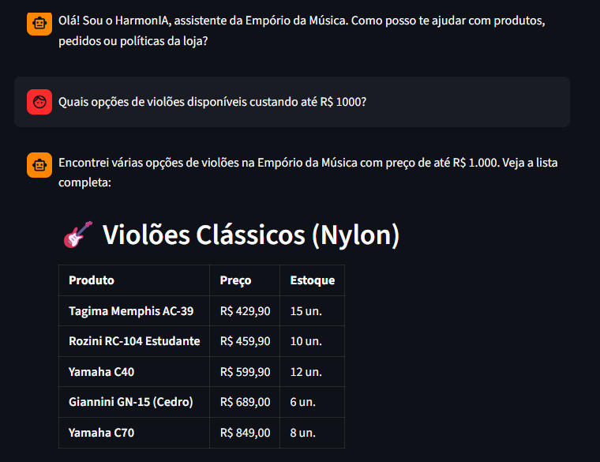
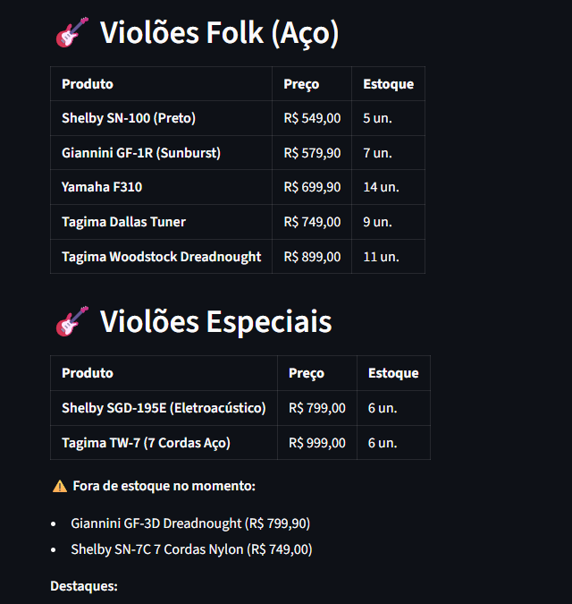
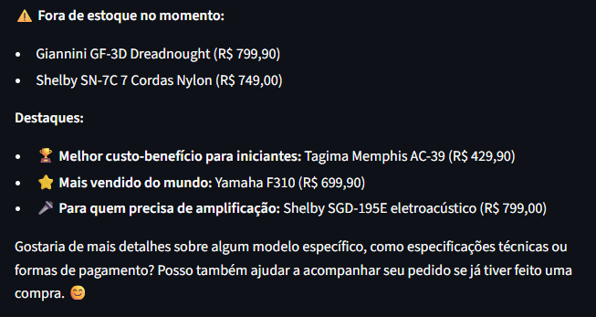

# Exemplo 1: Consulta ao Catálogo de Produtos

---

### Transcrição da Conversa

**Cliente:** Quais opções de violões disponíveis custando até R$ 1000?

**HarmonIA:** Encontrei várias opções de violões na Empório da Música com preço de até R$ 1.000. Veja a lista completa:

🎸 Violões Clássicos (Nylon)
Produto	Preço	Estoque
Tagima Memphis AC-39	R$ 429,90	15 un.
Rozini RC-104 Estudante	R$ 459,90	10 un.
Yamaha C40	R$ 599,90	12 un.
Giannini GN-15 (Cedro)	R$ 689,00	6 un.
Yamaha C70	R$ 849,00	8 un.
🎸 Violões Folk (Aço)
Produto	Preço	Estoque
Shelby SN-100 (Preto)	R$ 549,00	5 un.
Giannini GF-1R (Sunburst)	R$ 579,90	7 un.
Yamaha F310	R$ 699,90	14 un.
Tagima Dallas Tuner	R$ 749,00	9 un.
Tagima Woodstock Dreadnought	R$ 899,00	11 un.
🎸 Violões Especiais
Produto	Preço	Estoque
Shelby SGD-195E (Eletroacústico)	R$ 799,00	6 un.
Tagima TW-7 (7 Cordas Aço)	R$ 999,00	6 un.
⚠️ Fora de estoque no momento:

Giannini GF-3D Dreadnought (R$ 799,90)
Shelby SN-7C 7 Cordas Nylon (R$ 749,00)
Destaques:

🏆 Melhor custo-benefício para iniciantes: Tagima Memphis AC-39 (R$ 429,90)
⭐ Mais vendido do mundo: Yamaha F310 (R$ 699,90)
🎤 Para quem precisa de amplificação: Shelby SGD-195E eletroacústico (R$ 799,00)
Gostaria de mais detalhes sobre algum modelo específico, como especificações técnicas ou formas de pagamento? Posso também ajudar a acompanhar seu pedido se já tiver feito uma compra. 😊