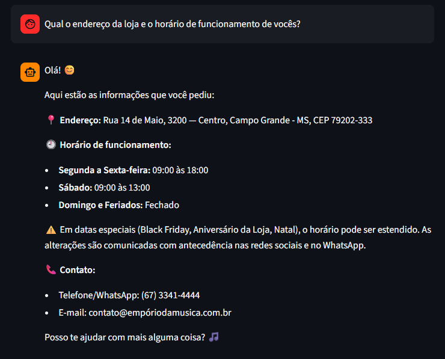

# Exemplo 2: Informações Gerais da Loja

---

### Transcrição da Conversa

**Cliente:** Qual o endereço da loja e o horário de funcionamento de vocês?

**HarmonIA:** Olá! 😊

Aqui estão as informações que você pediu:

📍 Endereço: Rua 14 de Maio, 3200 — Centro, Campo Grande - MS, CEP 79202-333

🕘 Horário de funcionamento:

Segunda a Sexta-feira: 09:00 às 18:00
Sábado: 09:00 às 13:00
Domingo e Feriados: Fechado
⚠️ Em datas especiais (Black Friday, Aniversário da Loja, Natal), o horário pode ser estendido. As alterações são comunicadas com antecedência nas redes sociais e no WhatsApp.

📞 Contato:

Telefone/WhatsApp: (67) 3341-4444
E-mail: contato@empóriodamusica.com.br
Posso te ajudar com mais alguma coisa? 🎵