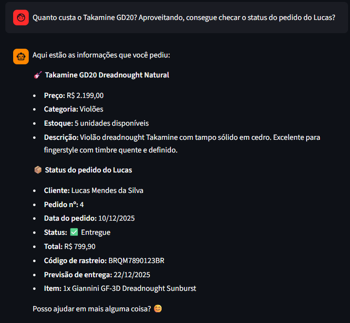

# Exemplo 3: Consulta de Preço e Status de Pedido

---

### Transcrição da Conversa

**Cliente:** Quanto custa o Takamine GD20? Aproveitando, consegue checar o status do pedido do Lucas?

**HarmonIA:** Aqui estão as informações que você pediu:

🎸 Takamine GD20 Dreadnought Natural

Preço: R$ 2.199,00
Categoria: Violões
Estoque: 5 unidades disponíveis
Descrição: Violão dreadnought Takamine com tampo sólido em cedro. Excelente para fingerstyle com timbre quente e definido.
📦 Status do pedido do Lucas

Cliente: Lucas Mendes da Silva
Pedido nº: 4
Data do pedido: 10/12/2025
Status: ✅ Entregue
Total: R$ 799,90
Código de rastreio: BRQM7890123BR
Previsão de entrega: 22/12/2025
Item: 1x Giannini GF-3D Dreadnought Sunburst
Posso ajudar em mais alguma coisa? 😊