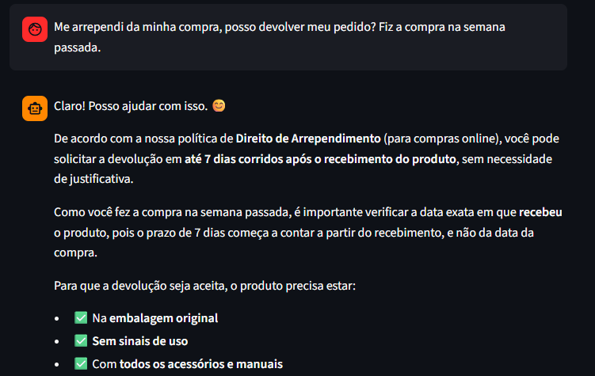
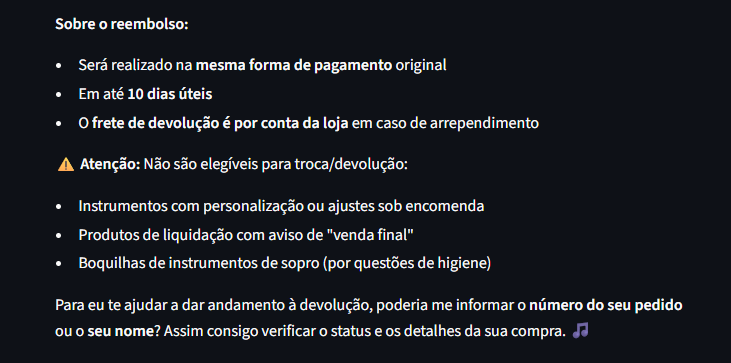

# Exemplo 4: Cenário Não Trivial — Arrependimento e Devolução de Pedido

---

### Transcrição da Conversa

**Cliente:** Me arrependi da minha compra, posso devolver meu pedido? Fiz a compra na semana passada.

**HarmonIA:** Claro! Posso ajudar com isso. 😊

De acordo com a nossa política de Direito de Arrependimento (para compras online), você pode solicitar a devolução em até 7 dias corridos após o recebimento do produto, sem necessidade de justificativa.

Como você fez a compra na semana passada, é importante verificar a data exata em que recebeu o produto, pois o prazo de 7 dias começa a contar a partir do recebimento, e não da data da compra.

Para que a devolução seja aceita, o produto precisa estar:

✅ Na embalagem original
✅ Sem sinais de uso
✅ Com todos os acessórios e manuais
Sobre o reembolso:

Será realizado na mesma forma de pagamento original
Em até 10 dias úteis
O frete de devolução é por conta da loja em caso de arrependimento
⚠️ Atenção: Não são elegíveis para troca/devolução:

Instrumentos com personalização ou ajustes sob encomenda
Produtos de liquidação com aviso de "venda final"
Boquilhas de instrumentos de sopro (por questões de higiene)
Para eu te ajudar a dar andamento à devolução, poderia me informar o número do seu pedido ou o seu nome? Assim consigo verificar o status e os detalhes da sua compra. 🎵